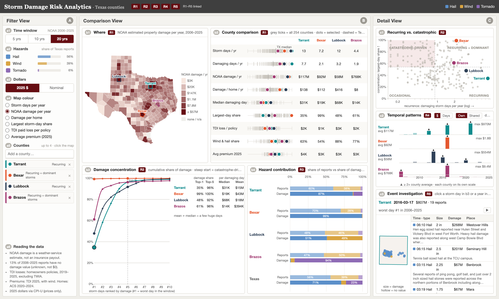
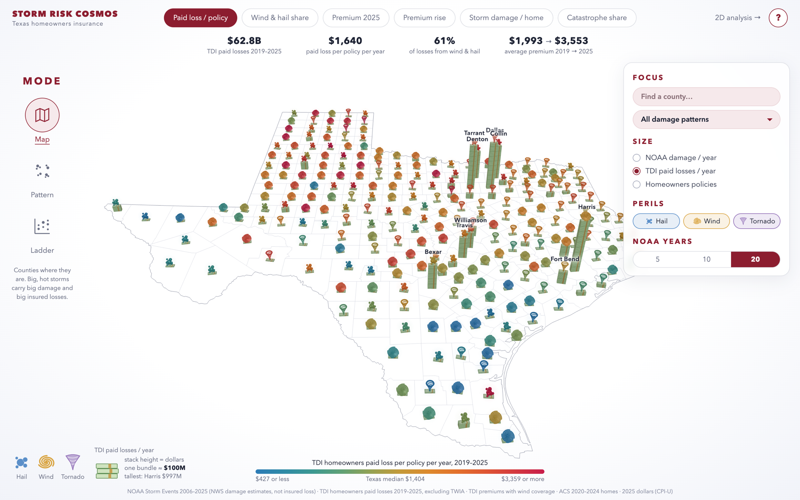

# Storm Damage Risk Analytics · Texas

An interactive visual analytics system for comparing **recurring versus catastrophic storm damage** across the 254 Texas counties. Similar county totals can hide very different storm-loss histories: one county loses a little every year, another loses almost everything on a single day. The system puts the storm record (NOAA Storm Events, 2006–2025) next to insured-loss context (TDI homeowners paid losses, 2019–2025) in one coordinated screen, with insurance premiums and housing counts for context, down to the individual storm reports behind any total.

CSCE 679 Data Visualization · Team 8: Aadi Mahajan, Abhinav Sheshadri, Hendro Setyawan, MD Imtiaz Mahi.



## Two views

* **`index.html` · Storm Risk Cosmos (3D story)**, live at https://stormcosmos.web.app: a seven-chapter 3D story for homeowners insurers. Every Texas county is a 3D storm shaped by the peril behind most of its damage (hail stones, thunderstorm-wind spiral, tornado funnel). Amounts stand under the storm as stacks of paper, one bundle = a fixed amount: green money, red "paid" bills for claims, blue policy paper for insured homes, rose sheets for homes without a policy. Chapters: storms reach every county → storms turn into damage → one big day or many small ones → insured and uninsured homes → premium in, claims out → few storms, many claims → where to grow, review and protect. Each chapter has one headline number and rings two counties that make its point by contrast (for example Dallas and Harris: the same storm days, $236M vs $5.6M of damage a year). Back / Next or the arrow keys move through it. After the last chapter (or with the Story / Explore toggle) **Explore** lets you pick any colour (main storm, one-day share, coverage, paid per policy, claims vs premium, claims vs storms, insurer view), layout (map, one day vs many, claims vs storms) and stack (property damage, insured vs uninsured homes, claims vs premium kept), and find a county. Click any county for its insurance card.
* **`analysis.html` · 2D analysis**: the full five-view dashboard described below.



## Five requirements

| | Requirement | Question | View |
|---|---|---|---|
| R1 | Geographic comparison | Why is County A different from County B? | b1 map · b2 county comparison |
| R2 | Recurring vs. catastrophic | Is the damage repeated or driven by a few storms? | b3 damage concentration · c1 typology |
| R3 | Hazard contribution | Which peril drives frequency, and which drives damage? | b4 hazard contribution |
| R4 | Temporal patterns | Which years stand out in a 5-, 10- or 20-year window? | c2 temporal patterns |
| R5 | Event investigation | Which storms are behind an unusual total or year? | c3 event investigation |

Data interpretation is a design principle across all five views, not a separate requirement: every view uses the same filters, NOAA estimates are labelled as estimates (not insured payouts), blank damage values are kept apart from $0, and source limits are listed in the filter view (a6).

## Layout

One screen, no scrolling, three coordinated views:

* **A · Filter view**: time window (5 / 10 / 20 years), hazards (hail, thunderstorm wind, tornado), dollars (2025 $ or nominal), map colour, up to four counties, notes on reading the data.
* **B · Comparison view**: **b1** choropleth map (click a county to compare it), **b2** county comparison (nine measures, each on its own axis: storm days, damaging days, damage, damage per home, median damaging day, largest-day share, TDI loss per policy, wind & hail share, average premium; all counties as grey ticks, selected counties as coloured dots, Texas median dashed), **b3** damage concentration (cumulative share of damage from the worst storm days, with top-1 / top-5 shares and median vs. mean damage per damaging day; click a day to open its reports), **b4** hazard contribution (share of reports vs. share of damage by peril, Texas as reference).
* **C · Detail view**: **c1** recurring vs. catastrophic typology (recurrence vs. concentration for every county, split at the Texas medians), **c2** temporal patterns (yearly damage or storm days per county on a shared year axis, years with at least twice the county's average marked ▲, each county on its own scale or one shared scale; drag across years to narrow every view to them, click a bar to open that year's worst storm day), **c3** event investigation (the NOAA reports behind the chosen storm day: time, type, size, damage, place and the National Weather Service narrative, with a locator map; step through a county's worst days with ◀ ▶).

A **storm day** is all hail, thunderstorm-wind and tornado reports in one county on one date, because NOAA often splits one storm into many reports.

## Run locally

```bash
python3 -m http.server 8000 --directory web
```

Then open http://localhost:8000 (3D story) or http://localhost:8000/analysis.html (2D analysis). D3, topojson-client and Three.js are included in `web/vendor/`, so no internet connection is needed.

## Rebuild the data

The prepared files are in `web/data/`. To rebuild them, download the sources into one folder and run:

```bash
python3 scripts/build_data.py --raw /path/to/raw
```

| Source | File | Use |
|---|---|---|
| NOAA NCEI Storm Events, details files 2006–2025 | `noaa_details/StormEvents_details-ftp_v1.0_dYYYY_c*.csv.gz` | storm days, damage and reports by peril |
| Texas Department of Insurance, homeowners losses by county 2019–2025 | `tdi_ho_losses_by_county.csv` | paid losses, wind & hail losses, policies |
| BLS CPI-U (FRED CPIAUCNS) | `cpi_u_monthly_fred.csv` | 2025-dollar adjustment |
| us-atlas county TopoJSON | `counties-10m.json` | Texas county boundaries |
| TDI homeowners market overview by county, 2019–2025 | `tdi_ho_premium_by_county.csv` | average premium and coverage |
| Census ACS 5-year 2020–2024 | `acs/tx_2024_b25001.csv`, `b25003.csv`, `b25077.csv` | housing units, owner-occupied homes, median home value |

## Caveats

* The event view lists every report NOAA filed for that county and date; locations are the report's starting point.
* NOAA property damage is a National Weather Service estimate, not insured loss; many reports have no damage value (shown as unknown, not $0).
* TDI paid losses cover homeowners policies only and exclude TWIA wind/hail policies.
* CPI-U adjusts for prices only, not for growth in the number or value of homes.
* Coverage is TDI homeowners policies divided by owner-occupied homes (ACS); homes insured through the Texas FAIR Plan or surplus lines are not counted, so the uncovered gap is an upper bound.
* Premium per county is estimated as policies × the TDI average premium (interpolated between 2019 and 2025), so "claims per premium dollar" is an estimate, not a reported loss ratio.
* In the 14 TWIA first-tier coastal counties most wind claims go to TWIA, which this data excludes; they are flagged and left out of the storm-vs-claim ranking and the insurer categories.
* The views support an analyst's investigation; they do not set rates.
