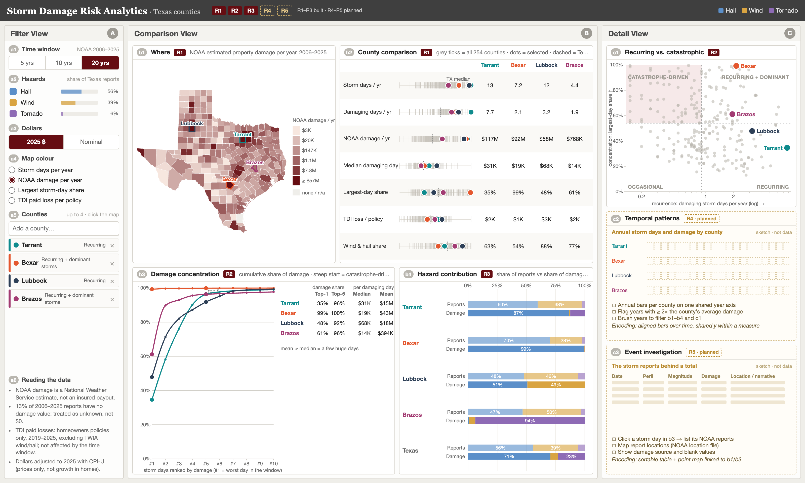

# Storm Damage Risk Analytics · Texas

An interactive visual analytics system for comparing **recurring versus catastrophic storm damage** across the 254 Texas counties. Similar county totals can hide very different storm-loss histories: one county loses a little every year, another loses almost everything on a single day. The system puts the storm record (NOAA Storm Events, 2006–2025) next to insured-loss context (TDI homeowners paid losses, 2019–2025) in one coordinated screen.

CSCE 679 Data Visualization · Team 8: Aadi Mahajan, Abhinav Sheshadri, Hendro Setyawan, MD Imtiaz Mahi.



## Five requirements and status

| | Requirement | Question | View | Status |
|---|---|---|---|---|
| R1 | Geographic comparison | Why is County A different from County B? | b1 map · b2 county comparison | Built |
| R2 | Recurring vs. catastrophic | Is the damage repeated or driven by a few storms? | b3 damage concentration · c1 typology | Built |
| R3 | Hazard contribution | Which peril drives frequency, and which drives damage? | b4 hazard contribution | Built |
| R4 | Temporal patterns | Which years stand out in a 5-, 10- or 20-year window? | c2 (design sketch) | Planned |
| R5 | Event investigation | Which storms are behind an unusual total or year? | c3 (design sketch) | Planned |

Data interpretation is a design principle across all five views, not a separate requirement: every view uses the same filters, NOAA estimates are labelled as estimates (not insured payouts), blank damage values are kept apart from $0, and source limits are listed in the filter view (a6).

## Layout

One screen, no scrolling, three coordinated views:

* **A · Filter view**: time window (5 / 10 / 20 years), hazards (hail, thunderstorm wind, tornado), dollars (2025 $ or nominal), map colour, up to four counties, notes on reading the data.
* **B · Comparison view**: **b1** choropleth map (click a county to compare it), **b2** county comparison (every measure on its own axis, all counties as grey ticks, selected counties as coloured dots, Texas median dashed), **b3** damage concentration (cumulative share of damage from the worst storm days, with top-1 / top-5 shares and median vs. mean damage per damaging day), **b4** hazard contribution (share of reports vs. share of damage by peril, Texas as reference).
* **C · Detail view**: **c1** recurring vs. catastrophic typology (recurrence vs. concentration for every county, split at the Texas medians), **c2** temporal patterns and **c3** event investigation as design sketches for the remaining work.

A **storm day** is all hail, thunderstorm-wind and tornado reports in one county on one date, because NOAA often splits one storm into many reports.

## Run locally

```bash
python3 -m http.server 8000 --directory web
```

Then open http://localhost:8000. D3 and topojson-client are included in `web/vendor/`, so no internet connection is needed.

## Rebuild the data

The prepared files are in `web/data/`. To rebuild them, download the sources into one folder and run:

```bash
python3 scripts/build_data.py --raw /path/to/raw
```

| Source | File | Use |
|---|---|---|
| NOAA NCEI Storm Events, details files 2006–2025 | `noaa_details/StormEvents_details-ftp_v1.0_dYYYY_c*.csv.gz` | storm days, damage and reports by peril |
| Texas Department of Insurance, homeowners losses by county 2019–2025 | `tdi_ho_losses_by_county.csv` | paid losses, wind & hail losses, policies |
| BLS CPI-U (FRED CPIAUCNS) | `cpi_u_monthly_fred.csv` | 2025-dollar adjustment |
| us-atlas county TopoJSON | `counties-10m.json` | Texas county boundaries |

## Caveats

* NOAA property damage is a National Weather Service estimate, not insured loss; many reports have no damage value (shown as unknown, not $0).
* TDI paid losses cover homeowners policies only and exclude TWIA wind/hail policies.
* CPI-U adjusts for prices only, not for growth in the number or value of homes.
* The views support an analyst's investigation; they do not set rates.
